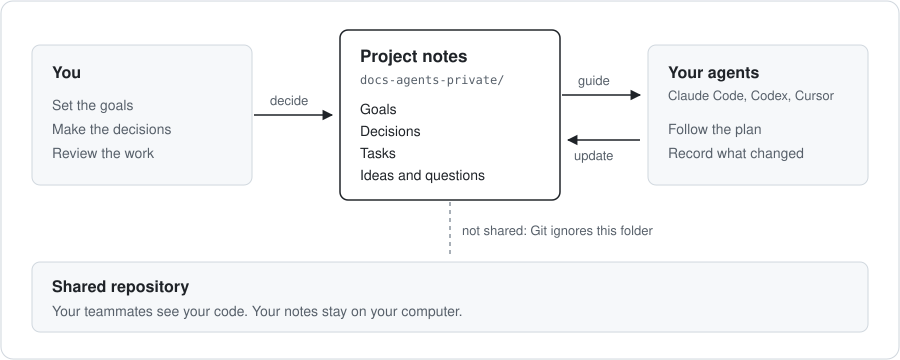

<h1 align="center">agents-control</h1>

<p align="center">
  <strong>Stay in charge of your work with coding agents.</strong>
</p>

<p align="center">
  <a href="https://github.com/patrickfleith/agents-control/actions/workflows/ci.yml"></a>
  <a href="LICENSE"></a>
  
</p>

Coding agents write code fast. Keeping the work organized is still your job.
Goals and decisions end up scattered across chats and loose notes. It gets
hard to see what was decided, why, and what to do next.

agents-control gives each project a small set of notes for this: goals,
decisions, tasks, ideas and open questions. You and your agents read and update
the same notes. You set the direction and make the decisions. Your agents work
from the notes and record what changed.

**On your own project**, the plan, the decisions and the next steps stay in one
place, whichever agent you use.

**In a team repository**, the notes are yours alone. Git leaves them out of the
shared repository, so you can plan your part of the work without adding files
for your teammates to review. Nobody else needs to install anything.

<p align="center">
  
</p>

[Quickstart](#quickstart) · [Workflows](#4-use-the-workflows) · [How it works](#how-it-works)

## What you get

- **Keep your plan when switching tools.** Set up Claude Code, Codex or Cursor
  to use the same notes.
- **Notes you can read and edit.** They are plain Markdown files. Fix a decision
  or delete an old note in your editor.
- **Runs locally.** A small command-line tool and a few agent instructions.
  There is no service to host.

## An example

You tell your agent: *"Use ac-decide to record that we chose SQLite for the
cache, because we don't want to run a database server."*

The agent adds this entry (shortened here) to `DECISIONS.md` in your notes folder:

```markdown
### DEC-004 — SQLite for the cache

**Decision:** Store the cache in SQLite.

**Rationale:** We don't want to run a separate database server.
```

Later, ask your agent: *"Build the cache using the decision in my project
notes."* If your needs change, use `ac-decide` again to record the new decision.

## Why not keep a notes file myself?

You can. agents-control saves you from setting it up in every project. It
creates the notes and gives your agents instructions for finding and updating
them. The `ac-commit` workflow tells your agent to check that no private notes
are staged before it commits.

Good to know: the notes stay in one folder on one computer. They are not synced
or backed up.

## Quickstart

Requires macOS or Linux, Git, curl, and a coding agent that can read local files.

### 1. Install once

```sh
curl -fsSL https://raw.githubusercontent.com/patrickfleith/agents-control/main/install.sh | sh
export PATH="$HOME/.local/bin:$PATH"
```

Add the PATH setting to your shell configuration for future terminals.
For Cursor, see [agent setup](#agent-setup).

### 2. Set up a project

Inside your project's Git checkout:

```sh
cd /path/to/your/project
agents-control init
```

This creates your Git-excluded `docs-agents-private/` folder and starter documents.

### 3. Fill your project context

Ask your agent:

> Use ac-init to fill my private project context from the codebase. Ask me about
> goals or requirements you cannot establish.

### 4. Use the workflows

Name a workflow in your request:

| Skill | Use it to |
| --- | --- |
| `ac-init` | Set up and fill private project context |
| `ac-log` | Capture a task, idea, technology choice, concern or question |
| `ac-decide` | Record, revise or revoke a decision with its rationale |
| `ac-glossary` | Define project terms and resolve conflicting meanings |
| `ac-write-manual` | Write or update a private user manual from the codebase |
| `ac-commit` | Organize code changes into atomic conventional commits |
| `ac-unslop` | Keep writing clear and concise |

Try these requests:

> Use ac-log to add a task: test retry behavior when the service is unavailable.

> Use ac-decide to record that we chose SQLite for the local cache because we
> need persistence without running a separate database service.

> Use ac-log to capture a concern: retrying a payment request could create a
> duplicate charge.

> Use ac-commit to organize these changes into commits.

## Details

### How it works

agents-control stores ordinary Markdown in `docs-agents-private/`, beside your
code. A small CLI handles setup and document paths. Personal `ac-` skills help
your agent keep the notes useful as you work. A skill is a reusable set of
instructions for a specific task.

Setup adds the folder to `.git/info/exclude`, the local Git exclusion file,
and preserves existing project files. Skills live in your user skill folders.
The writing workflows resolve private document paths before editing. `ac-commit`
checks the Git index for private files before each commit.

### Agent setup

For Codex and Claude Code, the installer adds personal skills and instructions
that ask the agent to load your project context. For Cursor, paste
`~/.agents-control/cursor-user-rule.md` into User Rules.

If your agent does not load the context automatically, ask:

> Run agents-control context and read the private documents relevant to this task.

Check your setup with:

```sh
agents-control doctor
```

For a local checkout of agents-control, see the
[local installation instructions](docs/usage.md#installation-and-discovery).

### What lives in the private folder?

```text
your-project/
  docs-agents-private/
    AGENTS.md       Personal instructions and document guide
    PRD.md          Project goals, requirements and users
    STACK.md        Technology choices
    ROADMAP.md      Upcoming work
    DECISIONS.md    Decisions and their reasons
    TASKS.md        Personal tasks
    CHANGELOG.md    Changes worth remembering
```

`init` creates the structure. You and your agent supply the project knowledge.
Rerunning setup preserves your existing notes. Linked worktrees share the private
folder in the main checkout, so notes survive when you remove a worktree.

Optional documents cover ideas, concerns, questions, terminology, a user manual,
tests, evaluations, interface guidelines and deployment. Larger features can have
their own requirements and implementation plan. Create these only when needed;
the [document guide](docs/usage.md#optional-documents) lists the available types.

### How context carries forward

At the start of a session, `agents-control context` returns personal instructions
and the private folder's location. Your agent reads the documents relevant to its
task. As you work, use the skills to capture decisions, questions and follow-up
work. The next session can pick up those files.

Keep notes current and focused. A short explanation of a decision or a concrete
next step is usually more useful than a transcript of the conversation.

### Updates and further reading

Rerun the installer to update. Your private notes stay in the main checkout. Locally
edited skills or conflicting files stop the update so you can review them.

- [Commands and document types](docs/usage.md)
- [Installation and context discovery](docs/usage.md#installation-and-discovery)
- [Upgrade from an older layout](docs/usage.md#upgrade-from-an-older-layout)
- [Development checks](docs/usage.md#development)

Licensed under [MIT](LICENSE).
